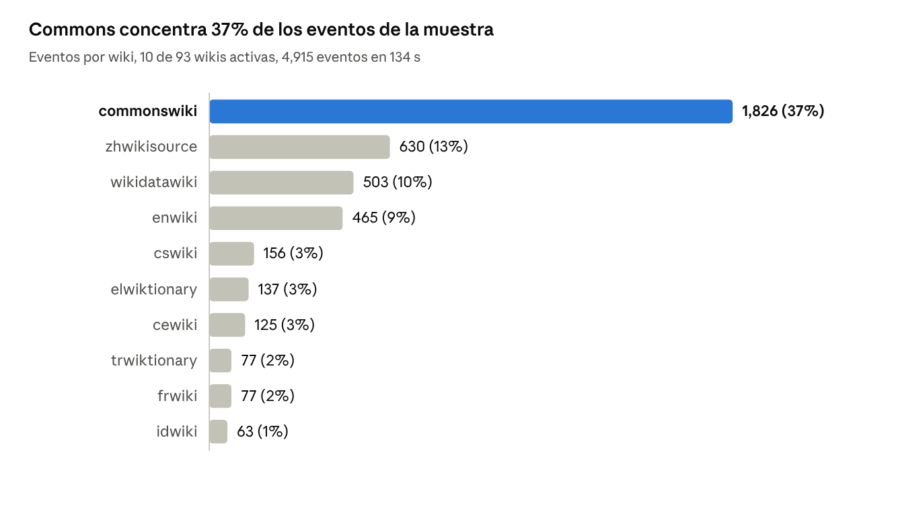
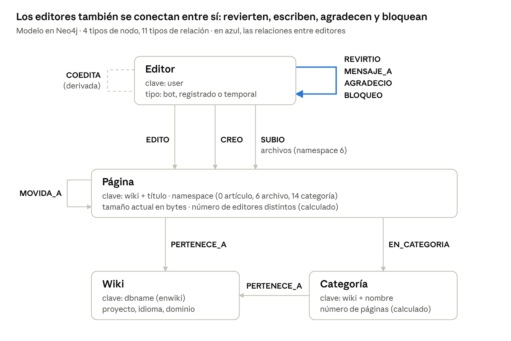
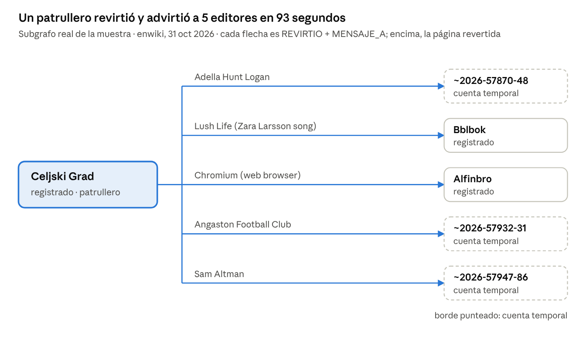

# Justificación del dataset: Wikipedia Recent Changes

Big Data · Proyecto Grupal II · UTEC

31 de octubre de 2026

## Resumen

Elegimos el stream **Wikipedia Recent Changes** de Wikimedia como fuente de datos del Proyecto Grupal II. Cumple los cuatro requisitos de la sección 1 de las instrucciones, y una captura de prueba del 31 de octubre de 2026 lo confirma: 4,915 eventos JSON en 134 segundos (~37 eventos/s), así que 50,000 registros se juntan en unos 23 minutos de captura.

El dataset encaja de forma natural con las tres bases de datos del curso:

- **MongoDB** guarda los eventos crudos, que tienen 4 tipos con campos distintos.
- **Cassandra** guarda las series de tiempo (ediciones por minuto, por wiki y por tipo).
- **Neo4j** guarda la red de editores, páginas, wikis y categorías, y las interacciones entre editores (reversiones, mensajes, agradecimientos y bloqueos).

El problema que planteamos es **monitorear la actividad colaborativa en los proyectos Wikimedia**: quién edita qué, cuánto del trabajo hacen los bots y qué páginas concentran ediciones de muchos editores (posibles conflictos o vandalismo).

## Origen del dataset

Los datos vienen del servicio público **EventStreams** de la Wikimedia Foundation. Emite en tiempo real cada cambio que ocurre en Wikipedia, Wikidata, Wikimedia Commons, Wiktionary y los demás proyectos hermanos, en todos los idiomas.

| Atributo | Valor |
| --- | --- |
| Endpoint | [stream.wikimedia.org/v2/stream/recentchange](https://stream.wikimedia.org/v2/stream/recentchange) |
| Protocolo | Server-Sent Events (SSE) sobre HTTP: cada evento llega como una línea `data: {json}` |
| Formato | JSON validado contra el esquema `/mediawiki/recentchange/1.0.x` |
| Autenticación | Ninguna. Solo se pide un `User-Agent` que identifique al cliente |
| Datos pasados | El parámetro `?since=<fecha ISO>` re-emite eventos de días anteriores (verificado con el 28 de octubre de 2026) |
| Licencia | Contenido bajo CC BY-SA 4.0; los metadatos de cambios son públicos |
| Documentación | [EventStreams en Wikitech](https://wikitech.wikimedia.org/wiki/Event_Platform/EventStreams_HTTP_Service) |

## Estructura del registro

Cada evento es un documento JSON con 16 campos comunes y campos extra que dependen del tipo. Eso lo hace semiestructurado: no todos los registros tienen la misma forma, y hay objetos anidados (`meta`, `length`, `revision`, `log_params`).

| Tipo (`type`) | Qué representa | Campos extra |
| --- | --- | --- |
| `edit` | Edición de una página existente | `length.old/new`, `revision.old/new`, `minor`, `patrolled`, `notify_url` |
| `new` | Creación de una página | Los mismos que `edit` (sin `length.old` ni `revision.old`) |
| `categorize` | Una página entra o sale de una categoría | `notify_url`; la página afectada va en `comment` |
| `log` | Acción administrativa: subida de archivo, traslado, bloqueo, filtro antiabuso, alta de usuario | `log_type`, `log_action`, `log_id`, `log_params` (estructura libre según la acción) |

Campos comunes más importantes: `id`, `type`, `title`, `namespace`, `user`, `bot`, `timestamp`, `wiki`, `server_name`, `comment` y `meta` (con `dt`, `domain`, `stream`, `offset`).

Ejemplo real de un evento `edit` capturado (se omiten `$schema`, `server_url`, `server_script_path` y parte de `meta`):

```json
{
  "meta": {"domain": "en.wikipedia.org", "dt": "2026-10-31T16:02:09.221Z",
           "stream": "mediawiki.recentchange", "offset": 2101181448},
  "id": 2085098516,
  "type": "edit",
  "namespace": 0,
  "title": "George Snowden",
  "comment": "",
  "timestamp": 1793462528,
  "user": "Guerreroast",
  "bot": false,
  "minor": false,
  "length": {"old": 5353, "new": 5357},
  "revision": {"old": 1383025501, "new": 1383025533},
  "server_name": "en.wikipedia.org",
  "wiki": "enwiki"
}
```

## Verificación empírica

Una captura de 134 segundos del 31 de octubre de 2026 trajo **4,915 eventos válidos**, unos 37 por segundo. A ese ritmo salen ~132,000 eventos por hora y ~3 millones por día, así que el mínimo de 50,000 se cubre con ~23 minutos de captura.

| Métrica de la muestra | Valor |
| --- | --- |
| Eventos por tipo | `categorize` 2,323 · `edit` 2,105 · `new` 260 · `log` 227 |
| Ediciones hechas por bots | 51.4% |
| Cuentas temporales (antes "anónimos por IP", formato `~2026-NNNNN-NN`) | 2.6% |
| Wikis distintas | 93 |
| Usuarios distintos | 607 |
| Páginas distintas | 2,758 |
| Usuarios que tocaron más de una página | 135 (el máximo: 216 páginas, un bot) |
| Ediciones menores (`minor`) | 27.9% de los `edit` |
| Cambio de tamaño por edición | mediana +38 bytes, promedio absoluto 950 bytes |



*Captura propia del stream recentchange · 31 oct 2026, 16:02 UTC · 134 s*

La actividad está muy concentrada: 4 wikis suman el 70% de los eventos. Eso da material para KPIs de concentración y para filtrar por proyecto en el dashboard.

## Cumplimiento de requisitos

El dataset cumple los cuatro requisitos de la sección 1 de las instrucciones, y su forma facilita los demás componentes del proyecto.

| Requisito del curso | Cómo lo cumple Wikipedia Recent Changes |
| --- | --- |
| Naturaleza semiestructurada | JSON con 4 tipos de evento de forma distinta, objetos anidados y un `log_params` de estructura libre |
| Al menos 50,000 registros | ~37 eventos/s medidos: 50,000 en ~23 min, ~3 millones por día |
| Actualización periódica o incremental | Stream continuo. Cada ejecución del DAG captura una ventana nueva y guarda el último `meta.dt` leído para continuar desde ahí |
| Origen, estructura y características documentados | Esquema JSON público y versionado (`/mediawiki/recentchange/1.0.x`) y documentación oficial en Wikitech |
| DAG de Airflow programado (sección 3) | La captura por ventanas encaja con un `schedule` horario o cada 15 minutos |
| Al menos 5 KPIs (sección 6) | Hay timestamp, usuario, bot, wiki, tamaño y tipo en cada evento: alcanza para más de 10 KPIs |

## Encaje multimodelo

Cada base de datos recibe la parte del dataset que mejor aprovecha su modelo. Este es el reparto preliminar, que se detalla en el informe técnico.

| Base | Qué guarda | Por qué ahí |
| --- | --- | --- |
| MongoDB | El evento original completo, en una colección `events` con índices por `wiki`, `type`, `user` y fecha | Esquema flexible: guarda los 4 tipos sin forzar columnas vacías. Permite consultar campos anidados (`length.new`, `log_params.target`) |
| Cassandra | Agregados por ventana de tiempo: eventos por minuto u hora y por wiki, tipo y bot/humano; actividad diaria por usuario; KPIs por fecha | Escrituras masivas y consultas por partición de fecha. El modelo se diseña según las consultas del dashboard ("últimas 24 h de enwiki") |
| Neo4j | Editores, páginas, wikis y categorías, con 11 tipos de relación, incluidas las interacciones entre editores (reversiones, mensajes, agradecimientos y bloqueos) | Las preguntas de "quién se conecta con quién" (quién revierte a quién, editores que comparten páginas, páginas con más editores) son recorridos de grafo, costosos con joins o agregaciones |

## Modelo de grafo preliminar



*Esquema del grafo · 4 tipos de nodo, 11 tipos de relación (COEDITA se deriva de EDITO)*

El grafo tiene dos capas. La primera conecta editores con el contenido (páginas, wikis y categorías). La segunda conecta editores entre sí, a partir de reversiones, mensajes, agradecimientos y bloqueos. Esa segunda capa es la que permite analizar conflictos y vandalismo. Todas las relaciones salen de campos que vienen en cada evento:

| Relación | Desde → hacia | Se obtiene de | Propiedades |
| --- | --- | --- | --- |
| `EDITO` | Editor → Página | Eventos `edit` | ediciones, Δbytes, última vez |
| `CREO` | Editor → Página | Eventos `new` | fecha, tamaño inicial |
| `SUBIO` | Editor → Página (archivo) | `log` de tipo `upload` | fecha |
| `REVIRTIO` | Editor → Editor | `edit` cuyo comentario es una reversión y enlaza a `[[Special:Contributions/X]]` | veces, wiki, última vez |
| `MENSAJE_A` | Editor → Editor | `edit` en la página de discusión de otro usuario (namespace 3) | mensajes, última vez |
| `AGRADECIO` | Editor → Editor | `log` de tipo `thanks` | veces |
| `BLOQUEO` | Editor → Editor | `log` de tipo `block` | duración, fecha |
| `COEDITA` | Editor — Editor | Calculada en Neo4j: dos `EDITO` hacia la misma página | páginas en común |
| `MOVIDA_A` | Página → Página | `log` de tipo `move` (`log_params.target`) | fecha, editor |
| `PERTENECE_A` | Página o Categoría → Wiki | Campo `wiki` | — |
| `EN_CATEGORIA` | Página → Categoría | Eventos `categorize` (enlace `[[...]]` del comentario) | fecha |

Con datos reales de la captura, la capa entre editores ya aparece. En 93 segundos, el patrullero Celjski Grad revirtió ediciones de 5 editores en 5 páginas de enwiki y dejó un aviso en la página de discusión de cada uno. Eso genera 5 relaciones `REVIRTIO` y 5 `MENSAJE_A`. Tres de los cinco editores revertidos usaban cuentas temporales.



*Datos reales de la captura del 31 oct 2026 · eventos edit y new de enwiki entre 16:02:29 y 16:04:02 UTC*

Este patrón (un nodo central con muchas reversiones salientes hacia cuentas temporales) es exactamente lo que el proyecto quiere medir. En la misma muestra hay 16 reversiones que nombran al editor revertido, 27 mensajes a páginas de discusión de usuarios y 4 bloqueos. Con horas o días acumulados, esta capa forma la red de patrullaje y vandalismo de cada wiki.

Consultas que este modelo responde directamente:

- **Página más disputada:** `MATCH (e:Editor)-[:EDITO]->(p:Pagina) RETURN p.titulo, count(DISTINCT e) AS editores ORDER BY editores DESC LIMIT 10`
- **Editores más revertidos** (posible vandalismo): `MATCH (:Editor)-[r:REVIRTIO]->(b:Editor) RETURN b.user, b.tipo, sum(r.veces) AS reversiones ORDER BY reversiones DESC LIMIT 10`
- **Patrulleros más activos:** la misma consulta, contando las reversiones que salen de cada editor.
- **Guerras de ediciones** (dos editores que se revierten mutuamente): `MATCH (a:Editor)-[:REVIRTIO]->(b:Editor)-[:REVIRTIO]->(a) WHERE a.user < b.user RETURN a.user, b.user`
- **Revertido y luego bloqueado:** editores con un `REVIRTIO` y un `BLOQUEO` entrantes, para medir cuánto vandalismo termina en sanción.
- **Editores que trabajan juntos:** `MATCH (a:Editor)-[:EDITO]->(p)<-[:EDITO]-(b:Editor) WHERE a.user < b.user RETURN a.user, b.user, count(p) AS comunes ORDER BY comunes DESC`
- **Editores en varias wikis:** recorrido Editor → Página → Wiki, contando wikis distintas por editor.

## KPIs candidatos

El dataset permite al menos 10 KPIs; el curso pide 5. Las fórmulas se calculan sobre una ventana de tiempo *t* (hora o día).

| KPI | Fórmula | Base de origen | Qué indica |
| --- | --- | --- | --- |
| Eventos procesados por hora/día | count(eventos en *t*) | Cassandra | Volumen y salud del pipeline |
| Crecimiento de actividad | (eventos *t* − eventos *t*−1) / eventos *t*−1 × 100 | Cassandra | Picos o caídas, por ejemplo ante una noticia |
| Tasa de automatización | eventos con `bot = true` / eventos totales × 100 | Cassandra | Cuánto del trabajo hacen bots (51% en la muestra) |
| Promedio de actividad por editor | eventos humanos / editores humanos distintos | Cassandra | Intensidad de la participación humana |
| Página más disputada | página con más editores distintos (grado de entrada de `EDITO`) | Neo4j | Posibles guerras de ediciones o temas de actualidad |
| Editor más conectado | editor con más páginas distintas, o más coeditores | Neo4j | Editores centrales de la comunidad |
| Tasa de creación de contenido | eventos `new` / (eventos `edit` + `new`) × 100 | MongoDB | Crecimiento frente a mantenimiento |
| Volumen neto de contenido | Σ (`length.new` − `length.old`) | MongoDB / Cassandra | Bytes agregados o eliminados; un valor muy negativo puede ser vandalismo |
| Tasa de reversión | ediciones revertidas / ediciones totales × 100 | Neo4j + MongoDB | Calidad de las ediciones; si sube, hay más vandalismo o conflicto |
| Editor más revertido | editor con más relaciones REVIRTIO entrantes | Neo4j | Candidatos a vandalismo; si lo revierten varios patrulleros distintos, la señal es más fuerte |
